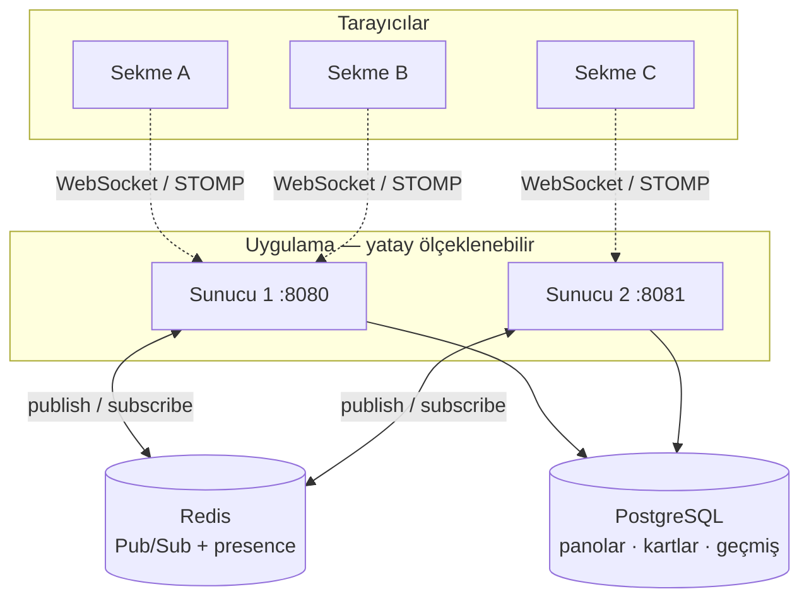
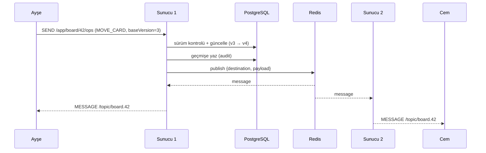
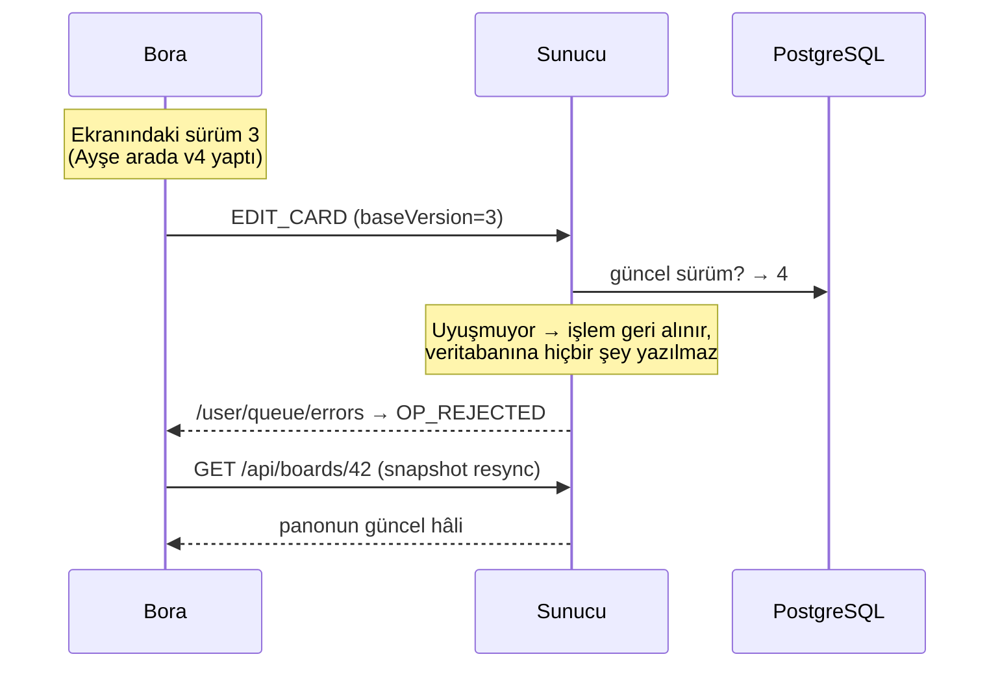
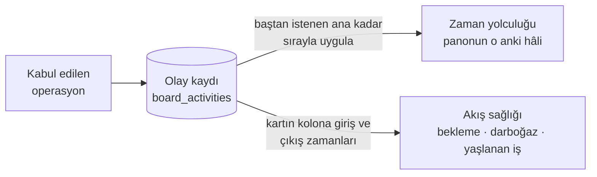

# CollabBoard — Gerçek Zamanlı İşbirlikçi Kanban Panosu

Birden çok kullanıcının **aynı anda** düzenlediği, her değişikliğin herkeste **anında** göründüğü bir Kanban panosu. Bir kişi kartı taşıdığında diğerlerinin ekranında da kayar — kimse sayfayı yenilemez.


[](https://github.com/erdemsidal/collab-board/actions/workflows/ci.yml)

---

## Neden ilginç?

İki taraftan bakılabilir.

**Ürün olarak** — sıradan bir Kanban panosunun cevaplayamadığı iki soruya cevap veriyor:

| Soru | Cevap |
|------|-------|
| **"Geçen salı bu pano nasıldı?"** | **Zaman yolculuğu.** Kaydırıcıyı geri çekersin, panonun o anki hâli yeniden kurulur — o gün var olan kolonlar ve sonradan silinmiş kartlar dahil |
| **"İşler nerede tıkanıyor?"** | **Akış sağlığı.** Kartların her kolonda ortalama ne kadar beklediği, darboğaz olan kolon ve en uzun süredir yerinden kıpırdamayan kartlar. **WIP limiti** ile darboğaz oluşmadan önlenir |

İkisi için de ayrı veri toplanmıyor. Her değişiklik zaten bir olay olarak kaydediliyor; geçmiş de ölçüm de o kayıttan hesaplanıyor — [ADR 0006](docs/adr/0006-olay-kaydi-uzerinden-gecmis-ve-akis.md).

**Mühendislik olarak** — bir CRUD uygulaması değil; gerçek zamanlı ve dağıtık sistemlerin üç zor sorusuna cevap veriyor:

| Soru | Cevap |
|------|-------|
| **Sunucu, istemciye polling olmadan nasıl haber verir?** | Sürekli açık WebSocket + STOMP pub/sub — [ADR 0002](docs/adr/0002-gercek-zamanli-protokol-stomp.md) |
| **İki kişi aynı kartı aynı anda değiştirirse ne olur?** | Optimistic sürüm kontrolü: bayat operasyon **reddedilir**, istemci kendini tazeler — [ADR 0003](docs/adr/0003-cakisma-cozumu-versiyon-kontrolu.md) |
| **Uygulamadan 2 kopya çalıştırınca canlı senkron neden bozulur?** | Abonelik defteri her sunucunun belleğindedir → **Redis Pub/Sub köprüsü** — [ADR 0004](docs/adr/0004-cok-sunucuya-olcekleme-redis-pubsub.md) |

Her önemli karar; alternatifleri, gerekçesi ve feda edilenlerle birlikte [`docs/adr/`](docs/adr/) altında yazılı.

---

## Özellikler

**Pano**

- **Canlı senkron** — kart ekleme / düzenleme / silme / sürükleyip taşıma, kolon ekleme / adlandırma / silme / sıralama; tüm istemcilerde anında.
- **Kart detayları** — açıklama, atanan kişi, son tarih. Son tarihi yaklaşan ve geçen kartlar ayrı renkte.
- **WIP limiti** — bir kolona aynı anda girebilecek kart sayısı. Dolan kolon yeni kart kabul etmez; iş başlatmak yerine bitirmeye zorlar — [ADR 0007](docs/adr/0007-wip-limiti-ve-kart-detaylari.md).
- **Arama ve süzme** — metin, "bana atananlar", geciken, kişiye göre.

**İçgörü**

- **Zaman yolculuğu** — panonun geçmişteki herhangi bir andaki hâli; kolon ekleme ve silmeleri de hesaba katarak — [ADR 0008](docs/adr/0008-kolon-yasam-dongusu-ve-gecmis-tohumlamasi.md).
- **Akış sağlığı** — kolon başına ortalama bekleme, çevrim süresi, darboğaz.
- **Yaşlanan iş** — açık kartların bulunduğu kolonda ne kadardır beklediği, en eskiden yeniye.
- **Pano geçmişi** — kim, ne zaman, ne yaptı. Reddedilen operasyon geçmişe yazılmaz.

**Gerçek zamanlı altyapı**

- **Çakışma koruması** — eşzamanlı düzenlemede sessiz veri kaybı yok. Reddedilen operasyon yalnızca gönderene bildirilir; istemci tam state ile kendini düzeltir.
- **Presence** — panoda kimlerin çevrimiçi olduğu, gerçek isim ve fotoğrafla. Sekme kapanınca anında düşer (polling yok).
- **Canlı imleçler** — panodaki herkes diğerlerinin faresini ve o an sürüklediği kartı görür; karşıdan gelen taşıma kart yeni yerine kayarak gider, pano titremez — [ADR 0014](docs/adr/0014-canli-imlec-ve-akici-tasima.md).
- **Kişisel bildirim kanalı** — davetler ve yanıtları, kişi hangi ekranda olursa olsun anında önüne düşer; çok sunucuda da — [ADR 0012](docs/adr/0012-onayli-davet-ve-kisisel-canli-bildirim.md).
- **Yatay ölçekleme** — birden çok uygulama kopyası, Redis üzerinden tek bir canlı yayın gibi davranır.
- **Metrikler** — açık bağlantı sayısı, uygulanan ve reddedilen operasyonlar; arayüzde canlı gösterge şeridi.

**Karşılama ve ana ekran**

- **Tanıtım sayfası** — oturumu olmayan ziyaretçi önce ürünü görür: canlı bir demo pano (imleçler kartları taşır, biri kart yazar), canlı akış şeridi, özellikler, Geçmiş / Akış / Ekip vitrinleri, "Nasıl çalışır", roller, "Hakkında" ve SSS; sağ üstte **Giriş yap** ve **Kayıt ol**. Ayrı dosyalarda (`landing.js`, `landing.css`), yalnızca gerektiğinde yüklenir; ekran dışındaki ve gizli sekmedeki animasyonlar durur, hareketi azaltma tercihine uyar — [ADR 0015](docs/adr/0015-tanitim-sayfasi-ve-ana-ekran-ozeti.md).
- **Koyu tasarım ("A · Gece")** — koyu tema varsayılan, açık tema tek tıkla (tarayıcı hatırlar); üst çubukta alan seçici, genel arama, "+ Yeni" menüsü, çevrimiçi ekip, zil ve hesap — [ADR 0017](docs/adr/0017-arayuz-yeniden-tasarimi.md).
- **Ana ekran** — kenar menüsü (sayılı kısayollar, son açılan panolar, çalışma alanları), bekleyen davet şeridi, dört özet kutusu, "Bana atanan kartlar" (Tümü / Bu hafta / Geciken), "Şu an canlı", son 7 günün hareket grafiği ve biten kart sayısı, panoların akış sağlığı, yaşlanan işler, son hareketler, pano kartları ve ekip. Yalnızca erişilebilen panolardan derlenir; "açık" = panonun son kolonunda olmayan kart.
- **Genel arama (Ctrl K / ⌘ K)** — panolar, kartlar ve komutlar tek kutuda; kartlar yalnızca erişilebilen panolardan gelir — [ADR 0016](docs/adr/0016-genel-arama.md). Kısayollar: `N` yeni kart, `G H` ana ekran.
- **Pano ekranı** — konum ve pano değiştirici, **Pano · Geçmiş · Akış** sekmeleri, panodakiler ve canlılık, davet penceresi; araç çubuğunda kart / geciken / darboğaz / ortalama çevrim sayıları; altta bağlantı durumu çubuğu.

**Hesap ve güvenlik**

- **Çalışma alanları ve roller** — panolar bir ekibe ait; ekibe bir kez davet edilen kişi o ekibin tüm panolarına erişir. Pano bazlı davet ise istisna olarak çalışır.
- **Onaylı davet** — kimse rızası olmadan panoya eklenmez: davet edilen kabul edince üye olur. Hesabı olmayan adrese kayıt bağlantısıyla posta gider; kaydolunca davet onu bekler — [ADR 0012](docs/adr/0012-onayli-davet-ve-kisisel-canli-bildirim.md).
- **Profil** — ad, şifre ve tarayıcıda kırpılan profil fotoğrafı; e-posta değiştirilemez. Şifre değişince diğer cihazlardaki oturumlar kapanır — [ADR 0013](docs/adr/0013-profil-ve-fotograf.md).
- **E-posta doğrulama** — hesap pasif açılır, postadaki bağlantıya tıklanana kadar giriş yapılamaz — [ADR 0009](docs/adr/0009-eposta-dogrulama.md).
- **Google ile devam et** — tek tıkla kayıt ve giriş (OpenID Connect, sunucu tarafı kod akışı). Aynı adresli hesap varsa ona bağlanır ve sahibine güvenlik postası gider; yoksa şifresiz hesap açılır, şifre sonradan belirlenebilir. Oturum jetonları adreste hiç görünmez: dönüşte tek kullanımlık, 60 saniyelik bir kod takas edilir. Akış oturumsuz (Redis'te), çok sunucuda çalışır. Google ayarlanmamışsa düğme görünmez — [ADR 0018](docs/adr/0018-google-ile-giris.md), [kurulum](docs/GOOGLE-GIRIS-KURULUMU.md).
- **Şifre sıfırlama** — 30 dakikalık tek kullanımlık bağlantı; sıfırlama bütün açık oturumları kapatır — [ADR 0011](docs/adr/0011-sifre-sifirlama.md).
- **Kimlik doğrulama** — JWT. WebSocket tarafında token, STOMP `CONNECT` frame'inde taşınır — [ADR 0005](docs/adr/0005-websocket-kimlik-dogrulama.md).
- **Kesintisiz oturum** — erişim jetonu 15 dakikalık; tarayıcı onu süresi dolmadan kendisi yeniler. Oturum her kullanımda sıfırdan başlayan 30 günlük süreyle yaşar; sekmeler yenilenen jetonu birbirine devreder. Süreler `JWT_ACCESS_TTL` / `JWT_REFRESH_TTL` ile değişir.
- **Hız sınırı** — giriş, kayıt ve posta gönderen uçlarda IP başına kota — [ADR 0010](docs/adr/0010-canliya-cikis-oncesi-guvenlik.md).

---

## Demo

<!--
GIF hazır olduğunda bu bloğu değiştir:

-->

Kendin denemek için iki tarayıcı penceresi aç — **ikisinde farklı hesapla giriş yap** (aynı tarayıcının iki sekmesi aynı oturumu paylaşır, bunun için gizli pencere ya da ikinci bir tarayıcı gerekir). Panoyu kuran kişi diğerini e-posta ile davet eder; sonra bir pencerede kartı sürükle, diğerinde de kaydığını gör.

Ekranda ne olduğunu görürsün: sağ üstte kimlerin çevrimiçi olduğu, sağ panelde kimin ne yaptığı, kolonlarda kartlar. Rolü **İzleyici** olan biri panoyu görür ama hiçbir şeyi değiştiremez — düzenleme öğeleri arayüzde hiç görünmez, sunucu da denemesi hâlinde reddeder.

Birkaç kart taşıdıktan sonra üst çubuktaki **Geçmiş** düğmesine bas: alttaki kaydırıcıyı geri çektikçe pano o anki hâline döner. Sağ paneldeki **Akış sağlığı** kartların nerede beklediğini, **Yaşlanan iş** listesi de en uzun süredir yerinden kıpırdamayanları gösterir.

Ölçeklemeyi görmek için aşağıdaki "iki sunucu" adımlarını uygula ve pencereleri farklı portlara bağla (`:8080` ve `:8081`) — senkron yine çalışır.

---

## Mimari



**İki kanal:** Panoya yeni giren istemci önce REST ile **tam fotoğrafı** alır (`GET /api/boards/{id}`), sonra WebSocket ile **o andan sonraki** değişiklikleri dinler. Maça geç kalınca önce skoru öğrenip sonra canlı izlemek gibi.

### Bir operasyonun yolculuğu



Yayınlayan sunucu **yerel gönderim yapmaz**: Redis mesajı kendi abonesine de dağıttığı için her olay her istemciye tam bir kez ulaşır.

### Çakışma: bayat operasyon nasıl reddedilir



Reddetme bildirimi **sadece gönderene** gider; diğer kullanıcılar bu gürültüyü görmez.

### Tek kayıt, iki özellik: geçmiş ve akış

Kabul edilen her operasyon, sonucuyla birlikte panonun olay kaydına yazılır (`board_activities`). Bu kayıt yalnızca bir "son hareketler" listesi değil, panonun **tarihinin kendisi**:



**Zaman yolculuğu** geriye doğru değil, **ileri** sarar: boş panodan başlar ve olayları istenen ana kadar sırayla uygular. Geriye doğru gitmek her operasyonun tersini tanımlamayı gerektirirdi — silinmiş bir kartı geri getirmek için içeriğini ayrıca saklamak gibi. İleri sarmada böyle bir borç yok.

Kolonlar eklenip silinebildiği için başlangıç hâli "bugünkü kolonlar" olamaz: dün eklenen kolon geçen haftada görünür, dün silinen hiç var olmamış gibi olurdu. Bu yüzden başlangıç, olay kaydından hesaplanır. Silme olayı da istemcinin kullanmadığı ad ve konum bilgisini taşır; silinen bir şeyi geçmişte gösterebilmenin tek yolu bu — [ADR 0008](docs/adr/0008-kolon-yasam-dongusu-ve-gecmis-tohumlamasi.md).

**Akış sağlığı** aynı kayıttan kartın bir kolona girdiği ve çıktığı anları okur; aradaki fark o kolondaki bekleme süresidir. Ortalaması en yüksek kolon darboğazdır. Ortalamalar bir kolonun genelini anlatır ama "hangi kart takıldı" demez — **yaşlanan iş** listesi bunu tek tek söyler.

Olay kaydı özelliği eklenmeden önce oluşmuş kartların giriş anı bilinmiyor. Onlar yok sayılmıyor: ilk hareketlerinden itibaren izleniyor, yaşları da oluşturulma anından hesaplanıp **tahmini** olarak işaretleniyor.

---

## Nasıl çalıştırılır

**Gerekenler:** Docker ve bir SMTP hesabı. Geliştirme yolu için ayrıca Java 21.

```bash
# E-posta ayarları — bu adım atlanamaz
cp .env.example .env      # MAIL_USERNAME ve MAIL_PASSWORD'ü doldur
```

Sonra iki yoldan biri:

| | Komut | Ne zaman |
|---|---|---|
| **Tek tık** | `docker compose up -d` — ya da Docker Desktop'ta ▶ | Denemek, göstermek. Java kurulu olması gerekmez; canlıya gidecek imajın aynısı çalışır |
| **Geliştirme** | `docker compose up -d postgres redis`<br>`./mvnw spring-boot:run -Dspring-boot.run.profiles=dev` | Kod yazarken. Değişiklikten sonra saniyeler içinde yeniden başlar; imaj yeniden derlenmez |

İkisi aynı anda çalışamaz — ikisi de 8080'i ister. Tek tık yolunda kodu değiştirdikten sonra imajı yeniden derlemek için: `docker compose up -d --build`.

Tarayıcıda `http://localhost:8080` → kayıt ol → **e-postandaki bağlantıya tıkla** → giriş yap.

> ### ⚠️ E-posta ayarı neden zorunlu?
>
> Kayıt olan hesap **pasif** açılır; kullanıcı e-postasındaki doğrulama bağlantısına tıklayana kadar giriş yapamaz ([ADR 0009](docs/adr/0009-eposta-dogrulama.md)). Posta ayarları eksikse bağlantı gönderilemez ve **hiç kimse içeri giremez.**
>
> Gmail ile ~5 dakikada kurulur (normal hesap şifresi değil, **Uygulama Şifresi** gerekir): **[docs/MAIL-KURULUMU.md](docs/MAIL-KURULUMU.md)**
>
> Uygulama açılışta SMTP bağlantısını sınar; ayar yanlışsa log'da açıkça yazar — ilk kullanıcı denemeden anlarsın.
>
> Yalnızca posta şablonu üzerinde çalışıyorsan gerçek gönderim yerine yerel yakalayıcıyı açabilirsin:
> `docker compose --profile mailpit up -d` + `-Dspring-boot.run.profiles=dev,mailpit` → postalar `http://localhost:8025`

Veritabanı ve Redis için ek ayar gerekmez: `application.yml` ile `docker-compose.yml` aynı varsayılanları kullanır (DB `collabboard`, kullanıcı `postgres`).

> ### Üretime çıkarken zorunlu değişkenler
>
> | Değişken | Neden |
> |---|---|
> | `JWT_SECRET` | Varsayılan anahtar bu depoda açıkta duruyor. `prod` profilinde uygulama onunla **açılmaz** — bilerek ([ADR 0010](docs/adr/0010-canliya-cikis-oncesi-guvenlik.md)) |
> | `CORS_ALLOWED_ORIGINS` | WebSocket'e hangi adreslerin bağlanabileceği. Joker (`*`) kabul edilmez |
> | `APP_BASE_URL` | Doğrulama postasındaki bağlantı buradan üretilir; verilmezse kullanıcının kendi makinesini gösterir |
> | `MAIL_*` | Doğrulama postaları. Railway SMTP portlarını kapattığı için orada `MAIL_PROVIDER=brevo` + `BREVO_API_KEY` ([kurulum](docs/MAIL-KURULUMU.md)) |
> | `DB_PASSWORD` | — |
> | `GOOGLE_CLIENT_ID` | *İsteğe bağlı.* "Google ile devam et" için Google Cloud Console'daki OAuth istemcisinin kimliği. Boşsa Google düğmesi görünmez ([kurulum](docs/GOOGLE-GIRIS-KURULUMU.md)) |
> | `GOOGLE_CLIENT_SECRET` | *İsteğe bağlı.* Aynı istemcinin gizli anahtarı; kimlikle birlikte verilmeli. Google'a kaydedilecek dönüş adresi: `<APP_BASE_URL>/login/oauth2/code/google` |
>
> İsteğe bağlı: `JWT_ACCESS_TTL` (varsayılan `15m`) ve `JWT_REFRESH_TTL` (varsayılan `30d`) — ayrıntısı [`.env.example`](.env.example)'da.
>
> Üretimde: `openssl rand -base64 64` ile anahtar üret.
>
> Adım adım canlıya alma, deneme listesi ve karşılaşılabilecek sorunlar: **[docs/CANLIYA-ALMA.md](docs/CANLIYA-ALMA.md)**

### Testler

```bash
./mvnw test
```

Ön koşul yok — **Testcontainers** testler için kendi Postgres ve Redis'ini Docker'da başlatır (elle `docker compose up` gerekmez). Sahte (mock) bileşen kullanılmaz: Flyway migration'ları, JPA eşlemeleri ve gerçek STOMP trafiği çalışır. Altyapıya bu kadar dayanan bir sistemde mock'lamak, test ettiğini sandığın şeyin çoğunu atlamak olurdu.

132 entegrasyon testi (ve 4 birim testi) şunları kapsar:

- **REST:** kimliksiz erişimin reddi, pano oluşturma (3 varsayılan kolon), tam state, doğrulama hatası
- **Canlı senkron:** bir istemcinin eklediği kart aynı panodaki herkese ulaşır
- **Sürüm artışı:** kart taşınınca yayınlanan olay güncel sürümü taşır
- **Çakışma:** bayat sürümle gelen operasyon reddedilir, reddetme yalnızca gönderene gider, ilk değişiklik korunur
- **Presence:** katılan kullanıcılar gerçek isimleriyle listelenir
- **Yetkilendirme:** üye olmayan panoyu göremez, `VIEWER` operasyonu reddedilir, üye olmayan panonun yayınına abone olamaz (okuma sızıntısı yok), panonun son sahibi çıkarılamaz
- **Çalışma alanı:** ekip üyesi ayrıca davet edilmeden panolara erişir, `GUEST` erişemez, pano bazlı istisna ekip rolünü ezer, ekipten çıkarılan kişi tüm panoları tek işlemde kaybeder
- **Güvenlik:** geçersiz token ile WebSocket bağlantısı kurulamaz
- **Şifre sıfırlama:** postadaki bağlantıyla yeni şifre belirlenir, eskisi çalışmaz; açık oturumların hepsi kapanır; bağlantı tek kullanımlık ve 30 dakikalık; veritabanında yalnızca jetonun özeti durur
- **Hız sınırı:** kayıt/giriş/doğrulama postası uçları kotayı aşınca 429 ve `Retry-After` döner, sınırlanmayan uçlar etkilenmez
- **E-posta doğrulama:** kayıt hesabı pasif açar, doğrulanmamış giriş reddedilir, bağlantı tek kullanımlıktır, süresi dolan reddedilir, yeniden gönderim eskisini geçersiz kılar ve kayıtsız adresin varlığını ele vermez
- **Google ile giriş:** ayarsız uygulama düğme göstermez; ayarlıysa Google'a doğru istemci, dönüş adresi (`APP_BASE_URL`'den), kapsamlar, `state`, nonce ve PKCE ile gidilir, oturum çerezi doğmaz; vazgeçen kişi `cancelled`, başka tarayıcıdan gelen ya da tekrarlanan dönüş `failed` alır; yeni kişiye etkin ve şifresiz hesap açılır, karşılama postası gider; aynı Google hesabı ikinci kez aynı hesaba girer, posta gitmez; aynı adresli şifreli hesaba bağlanır, güvenlik postası gider, şifre çalışmaya devam eder; doğrulanmamış hesap etkinleşir, kayıttaki şifre silinir; Google'ın doğrulamadığı adres reddedilir; bu adrese gönderilmiş bekleyen davet görünür ve kabul edilir; tek kullanımlık kod giriş yanıtının aynısını döner, ikinci kullanımda, süresi dolunca ya da başka tarayıcıdan gelince 400; şifresiz hesapla şifreli giriş yanlış şifreyle aynı reddedilir, şifre mevcut şifre sorulmadan ya da "Şifremi unuttum" ile belirlenir, şifreli hesap mevcut şifreyi vermek zorunda kalır
- **WIP limiti:** dolu kolona kart eklenemez/taşınamaz, kolon içi sıralama limitte de çalışır, sınır kaldırılınca kolon yeniden kart kabul eder
- **Kart detayları:** açıklama/atanan/son tarih kaydedilir, boşaltılabilir, geçmişte de geri gelir
- **Kolon yaşam döngüsü:** ekleme/adlandırma/silme/taşıma, silinen kolonun kartları da gider, taşımada aradakiler kayar (iki kolon aynı sıraya düşmez), geçmişte kolonlar o anki hâliyle görünür
- **Genel arama:** yalnızca erişilebilen panolarda arar (yabancı panodaki aynı kelime görünmez); kısa sorgu boş, uzun sorgu 400; `%` ve `_` düz karakter; Türkçe büyük/küçük harf eşleşir
- **Akış ölçümü:** kolon doluluğu ve çevrim süresi hesaplanır, yaşlanan iş listesi en eskiden yeniye sıralanır
- **Davet:** davet, davet edilene hangi ekranda olursa olsun canlı ulaşır; kabul üyelik açar ve davet edene haber verir, ret açmaz; daveti yalnızca davet edilen yanıtlayabilir; geri çekilen davet kabul edilemez; hesabı olmayan adres kaydolunca daveti bulur; aynı adrese ikinci bekleyen davet reddedilir; bekleyen davetleri yalnızca yönetici görür; rol değiştirme yeni kişi eklemenin arka kapısı değildir
- **Profil:** ad değişir, e-posta değişmez; şifre değişince diğer oturumlar kapanır, bu cihaz yeni jetonla sürer; yanlış mevcut şifre reddedilir; fotoğraf türü uzantıdan değil içerikten anlaşılır (görsel kılığındaki betik reddedilir), değişince adresi de değişir
- **Zaman biçimi:** zamanlar saat dilimi işaretiyle (`…Z`) gider; tarayıcı nerede olursa olsun doğru anı gösterir
- **Canlı ayarları:** `prod` profilinde iç metrikler dışarıya kapalı, sağlık kontrolü açık; olmayan adres (`/favicon.ico`, kapalı Swagger) 500 değil 404 döner
- **Ana ekran özeti:** yalnızca erişilebilen panolardan derlenir (sahip, davet, çalışma alanı üyeliği; yabancı panodaki kart sızmaz); son kolondaki kart açık sayılmaz; hareketler en yeniden eskiye; boş kullanıcı boş özet alır; bozuk gün 400, kimliksiz istek 401
- **Herkese açık dosyalar:** giriş öncesi arayüz dosyaları (sayfa, `collab-api.js`, `landing.js`, `landing.css`, simgeler) kimliksiz sunulur
- **Canlı imleç:** panoya katılan kişinin imleci sunucunun bildiği adıyla diğer üyelere ulaşır; katılmamış oturumun imleci yayınlanmaz; çok sık gelen konumlar seyreltilir, "ayrıldı" mesajı her zaman geçer
- **Test yalıtımı:** testler geliştiricinin `.env` dosyasını okumaz, posta her zaman sahte kutuya gider
- **Posta (Brevo):** istek Brevo'nun beklediği biçimde gider (anahtar başlıkta, Türkçe bozulmadan), ret sebebi hata mesajında görünür
- **Oturum:** süresi dolmuş erişim jetonu 401 alır (403 değil — istemci bunu "yenile" diye okur), yenilenen jetonla istek geçer; yetkisi olmayan kişi 403 almaya devam eder; her yenileme oturumu tam süreyle baştan başlatır

### İki sunucuyla ölçeklemeyi görmek

```bash
# 1. kopya :8080'de çalışırken, 2. kopyayı başka porttan başlat:
./mvnw spring-boot:run -Dspring-boot.run.arguments=--server.port=8081
```

Bir sekmeyi `:8080`, diğerini `:8081` üzerinden **aynı** panoya bağla — canlı senkron sunucular arasında da çalışır. Redis'i durdurup denersen bozulduğunu, tekrar başlatınca düzeldiğini görebilirsin.

---

## API

### REST — "tam fotoğraf" kanalı

| Uç | Açıklama |
|----|----------|
| `POST /api/auth/register` · `POST /api/auth/login` | Kayıt / giriş (JWT). Kayıt hesabı pasif açar |
| `GET /api/auth/verify?token=` | E-posta doğrulama (postadaki bağlantı) |
| `POST /api/auth/resend-verification` | Doğrulama postasını yeniden gönder |
| `POST /api/auth/forgot-password` · `POST /api/auth/reset-password` | Şifre sıfırlama bağlantısı iste / yeni şifreyi belirle |
| `GET /api/auth/providers` | Kurulu dış hesap sağlayıcıları: `{"providers":[{"id":"google","name":"Google"}]}`; Google ayarlanmamışsa boş liste |
| `GET /oauth2/authorization/google` | Tarayıcı buraya gider: Google'a yönlendirir. Dönüş `/login/oauth2/code/google`; sonuç `/?oauth=<kod>` ya da `/?oauth_error=cancelled\|email_unverified\|failed` |
| `POST /api/auth/oauth/exchange` | `{"code":"..."}` → giriş yanıtının aynısı (jetonlar + kullanıcı). Kod tek kullanımlık, 60 saniyelik, akışı başlatan tarayıcıya bağlı; değilse `400` |
| `POST /api/boards` | Pano oluştur (To Do · In Progress · Done kolonlarıyla) |
| `GET /api/boards/{id}` | Panonun tam hâli (kolonlar + kartlar) |
| `GET /api/boards/{id}/activity?limit=20` | Son hareketler |
| `GET /api/boards/{id}/timeline` | Geri sarılabilecek anlar |
| `GET /api/boards/{id}/history?upTo={olayId}` | Panonun o andaki hâli |
| `GET /api/boards/{id}/flow` | Akış sağlığı: bekleme süreleri, darboğaz, yaşlanan iş |

Kayıtlı olmayan bir adres için doğrulama ve sıfırlama uçları kayıtlı adresle **aynı** cevabı verir; aksi hâlde bu uçlar hangi e-postaların sistemde olduğunu sorgulamaya yarardı.

### Çalışma alanları, roller ve yetkilendirme

Panolar tek tek kullanıcılara değil bir **çalışma alanına** (ekip/şirket) aittir. Böyle olmasının sebebi pratik: 20 kişilik bir ekipte her yeni panoya herkesi tek tek davet etmek, işten ayrılan birini her panodan ayrı ayrı çıkarmak sürdürülemez. Ekip üyeliği tek noktadan yönetilir; pano bazlı davet ise **istisna** olarak kalır — dışarıdan bir misafiri tek bir panoya çağırmak ya da bir ekip üyesini hassas bir panoda kısıtlamak için.

Kullanıcı için hesabına ilk pano açıldığında bir "Kişisel Alan" oluşturulur; yani sahipsiz pano diye bir durum yoktur.

**Çalışma alanı rolleri**

| Rol | Alanın panolarına | Üye yönetimi | Pano açma |
|-----|:---:|:---:|:---:|
| `OWNER` / `ADMIN` | tam yetki | ✅ | ✅ |
| `MEMBER` | düzenler | — | ✅ |
| `GUEST` | erişemez | — | — |

**Pano rolleri** (çalışma alanı rolünü ezen istisna)

| Rol | Panoyu görür | Kart/kolon değiştirir | Üye yönetir |
|-----|:---:|:---:|:---:|
| `OWNER` | ✅ | ✅ | ✅ |
| `EDITOR` | ✅ | ✅ | — |
| `VIEWER` | ✅ | — | — |

Etkin rol tek bir yerde çözülür: önce panoya özel kayda, yoksa çalışma alanı üyeliğine bakılır (`OWNER`/`ADMIN` → pano sahibi, `MEMBER` → editör, `GUEST` → erişim yok). Kontroller tek kapıdan (`BoardAccessService`) geçtiği için çalışma alanı katmanı eklenirken controller'lar, servisler ve WebSocket interceptor'ı hiç değişmedi.

| Uç | Açıklama |
|----|----------|
| `GET /api/workspaces` | Üyesi olduğum çalışma alanları (rolümle) |
| `POST /api/workspaces` | Alan kur (kuran `OWNER` olur) |
| `PATCH /api/workspaces/{id}` · `DELETE …` | Ad değiştir / sil — yalnızca `OWNER`/`ADMIN`. Silme, içindeki panoları da kaldırır |
| `GET /api/boards` | Erişebildiğim panolar (rol, kart ve üye sayısıyla) |
| `GET /api/boards/{id}/members` | Üye listesi (üyelik gerekir) |
| `PATCH /api/boards/{id}/members/{userId}` | Mevcut üyenin rolünü değiştir (yalnızca `OWNER`). Yeni kişi davetle gelir |
| `DELETE /api/boards/{id}/members/{userId}` | Üyeyi çıkar (yalnızca `OWNER`) |

Tasarımda dikkat edilenler:

- **Yetki hem REST hem WebSocket tarafında uygulanır.** Yalnızca REST korunsaydı, üye olmayan biri `/topic/board.{id}`'ye abone olup her değişikliği canlı izleyebilirdi — yazamadan okuyabilmek de bir sızıntıdır. Abonelikler ayrı bir interceptor ile denetlenir.
- **Panonun varlığı sızdırılmaz:** olmayan pano da, yetkisiz pano da `403` döner. Farklı cevap verilseydi id denenerek hangi panoların var olduğu öğrenilebilirdi.
- **Son `OWNER` çıkarılamaz** veya rolü düşürülemez; aksi hâlde pano kimsenin yönetemediği bir duruma düşerdi.
- Arayüzdeki kısıtlamalar (gizlenen düğmeler, kapatılan sürükleme) yalnızca **deneyim** içindir; yetkiyi sunucu uygular.

### Davetler, bildirimler ve profil

| Uç | Açıklama |
|----|----------|
| `POST /api/boards/{id}/invitations` | E-postayla davet et (yalnızca `OWNER`). Hesabı varsa canlı bildirim, yoksa kayıt bağlantılı posta |
| `GET /api/boards/{id}/invitations` | Bekleyen davetler (yalnızca `OWNER` — e-posta adresleri içerir) |
| `DELETE /api/boards/{id}/invitations/{invitationId}` | Daveti geri çek |
| `POST /api/invitations/{id}/accept` · `…/decline` | Daveti kabul et / reddet (yalnızca davet edilen) |
| `GET /api/me/overview?today=YYYY-MM-DD` | Ana ekran özeti: sayılar, bana atanan açık kartlar (en yakın son tarih önce), son hareketler, son 7 gün, biten kartlar, canlı panolar, ekip, pano sağlığı, yaşlanan işler. `today` tarayıcının yerel günü |
| `GET /api/search?q=…` | Genel arama: erişilebilen panolarda pano adı ve kart başlığı/açıklaması, en fazla 8'er sonuç; 2 karakterden kısa sorgu boş, 100'den uzunu `400` |
| `GET /api/notifications?limit=30` | Bildirimler ve okunmamış sayısı |
| `POST /api/notifications/{id}/read` · `POST /api/notifications/read-all` | Okundu işaretle |
| `GET /api/users/me` · `PATCH /api/users/me` | Profilim / ad-soyad değiştir (`email` alanı gelirse `400`). Yanıtta `hasPassword` ve bağlı sağlayıcılar (`providers`, ör. `["google"]`) |
| `POST /api/users/me/password` | Şifre değiştir; diğer oturumlar kapanır, yeni jeton çifti döner. Hesabın şifresi yoksa (Google ile açıldıysa) `currentPassword` gerekmez |
| `PUT /api/users/me/avatar` · `DELETE …` | Fotoğraf yükle (`multipart`, PNG/JPEG/WebP, ≤ 512 KB) / kaldır |
| `GET /api/avatars/{anahtar}` | Fotoğraf (kimliksiz; rastgele anahtarlı, bir yıl önbellek) |

### WebSocket / STOMP — canlı kanal

| Adres | Yön | Açıklama |
|-------|-----|----------|
| `/ws` | — | El sıkışma; kimlik `CONNECT` frame'indeki `Authorization` başlığında |
| `/app/board/{id}/ops` | istemci → sunucu | Operasyon gönder |
| `/app/board/{id}/presence/join` | istemci → sunucu | Panoya katıl |
| `/topic/board.{id}` | sunucu → istemciler | Pano olayları |
| `/topic/board.{id}/presence` | sunucu → istemciler | Çevrimiçi listesi |
| `/app/board/{id}/cursor` | istemci → sunucu | İmleç konumu ve sürüklenen kart (kaydedilmez; yalnızca panoya katılmış oturumdan) |
| `/topic/board.{id}/cursors` | sunucu → istemciler | Diğerlerinin imleçleri |
| `/user/queue/errors` | sunucu → **tek istemci** | Reddedilen operasyon bildirimi |
| `/user/queue/notifications` | sunucu → **tek kişi** | Davet ve bildirimler; panodan bağımsız, oturum boyunca açık |

**Operasyonlar**, `type` alanına göre ayrışan tek bir mesaj tipidir (`sealed interface` + Jackson polimorfizmi):

```json
{ "type": "ADD_CARD",      "columnId": 1, "title": "Süt al" }
{ "type": "MOVE_CARD",     "cardId": 7, "toColumnId": 3, "position": 0, "baseVersion": 4 }
{ "type": "EDIT_CARD",     "cardId": 7, "title": "2L süt", "description": "…",
                           "assigneeId": 12, "dueDate": "2026-10-15", "baseVersion": 4 }
{ "type": "DELETE_CARD",   "cardId": 7 }
{ "type": "ADD_COLUMN",    "boardId": 42, "name": "İncelemede" }
{ "type": "RENAME_COLUMN", "columnId": 1, "name": "Yapılacaklar" }
{ "type": "DELETE_COLUMN", "columnId": 1 }
{ "type": "MOVE_COLUMN",   "columnId": 1, "position": 2 }
{ "type": "SET_WIP_LIMIT", "columnId": 2, "limit": 3 }
```

`EDIT_CARD` düzenlenebilir alanların tamamını taşır; gönderilmeyen alan temizlenir. `baseVersion` istemcinin gördüğü hâlin üzerine yazdığını garanti ettiği için bu güvenli — ve "boş gelen alana dokunma" kuralı bir alanı boşaltmayı imkânsız kılardı.

Reddetme sebepleri: `STALE_VERSION` (araya başkası girdi), `WIP_LIMIT` (kolon dolu), `FORBIDDEN`, `NOT_FOUND`, `INVALID`.

Operasyon kümesi `sealed` olduğu için, yeni bir tip eklendiğinde onu işleyen `switch` güncellenmezse **kod derlenmez** — kapsam büyüdükçe güvenlik ağı derleyicidedir.

### Metrikler

```
GET /actuator/metrics/collabboard.ws.connections
GET /actuator/metrics/collabboard.operations?tag=type:MOVE_CARD
GET /actuator/metrics/collabboard.operations.rejected
```

`operations.rejected`, çakışma korumasının ne kadar iş yaptığının ölçüsüdür.

Metrikler yalnızca **yerelde** açık. Canlıda (`prod` profili) dışarıya yalnızca `/actuator/health` açılır; metrikler sunucunun iç yapısını (bellek, istek sayıları, sürümler) anlattığı için herkese açık durmamalı. Arayüzün alt şeridindeki sayılar sunucudan değil, o tarayıcının kendi sayaçlarından gelir (gönderilen işlem, bağlantı, üye sayısı).

---

## Mimari kararlar (ADR)

| No | Karar |
|----|-------|
| [0001](docs/adr/0001-operasyon-tabanli-model-ve-cakisma-cozumu.md) | Operasyon tabanlı model + versiyonlama/LWW (OT/CRDT **değil**) |
| [0002](docs/adr/0002-gercek-zamanli-protokol-stomp.md) | STOMP over WebSocket (ham WebSocket / SSE değil) |
| [0003](docs/adr/0003-cakisma-cozumu-versiyon-kontrolu.md) | Optimistic sürüm kontrolü + snapshot resync |
| [0004](docs/adr/0004-cok-sunucuya-olcekleme-redis-pubsub.md) | Redis Pub/Sub köprüsü (sticky session / RabbitMQ değil) |
| [0005](docs/adr/0005-websocket-kimlik-dogrulama.md) | JWT, STOMP `CONNECT` frame'inde (URL'de değil) |
| [0006](docs/adr/0006-olay-kaydi-uzerinden-gecmis-ve-akis.md) | Geçmiş ve akış ölçümü olay kaydından (ayrı tablo değil) |
| [0007](docs/adr/0007-wip-limiti-ve-kart-detaylari.md) | WIP limiti + kart detayları |
| [0008](docs/adr/0008-kolon-yasam-dongusu-ve-gecmis-tohumlamasi.md) | Kolon yaşam döngüsü; geçmişin başlangıç hâlinin hesaplanması |
| [0009](docs/adr/0009-eposta-dogrulama.md) | E-posta doğrulama; gerçek SMTP varsayılan, açılışta bağlantı sınaması |
| [0010](docs/adr/0010-canliya-cikis-oncesi-guvenlik.md) | Origin denetimi, üretimde açık JWT anahtarı yasağı, hız sınırı |
| [0011](docs/adr/0011-sifre-sifirlama.md) | Şifre sıfırlama; jeton özeti, oturumların kapatılması |
| [0012](docs/adr/0012-onayli-davet-ve-kisisel-canli-bildirim.md) | Onaylı davet; kişiye özel canlı kanal (polling değil) |
| [0013](docs/adr/0013-profil-ve-fotograf.md) | Profil, şifre değiştirme; fotoğraf Postgres'te, içerikten tür tespiti |
| [0014](docs/adr/0014-canli-imlec-ve-akici-tasima.md) | Canlı imleçler; FLIP ile akıcı yeniden çizim, sürüklerken olayların bekletilmesi |
| [0015](docs/adr/0015-tanitim-sayfasi-ve-ana-ekran-ozeti.md) | Tanıtım sayfası ayrı dosyada; ana ekran özeti tek uçtan, erişim kuralı tek yerden |
| [0016](docs/adr/0016-genel-arama.md) | Genel arama: erişilebilen panolarda, kaçışlanmış LIKE |
| [0017](docs/adr/0017-arayuz-yeniden-tasarimi.md) | Koyu tasarım; değişkenlerle tema, komut paleti, Pano · Geçmiş · Akış sekmeleri |
| [0018](docs/adr/0018-google-ile-giris.md) | Google ile giriş: sunucu tarafı kod akışı, akış Redis'te (oturum yok), adreste jeton değil tek kullanımlık kod, doğrulanmış adresle bağlama |

---

## Proje yapısı

Özelliğe göre paketleme (package-by-feature):

```
com.collabboard
├── board/          Kanban domaini: entity, REST, operasyonlar, STOMP controller,
│   │               üyelik ve erişim kontrolü (BoardAccessService)
│   └── operation/  sealed BoardOperation + olay (event) tipleri
├── workspace/      Çalışma alanları, ekip üyeliği ve rolleri
├── realtime/       Redis Pub/Sub köprüsü (BroadcastService + subscriber)
├── presence/       Kim çevrimiçi (Redis hash + WebSocket oturum olayları)
├── audit/          Olay kaydı — geçmişin ve akış ölçümünün kaynağı
├── observability/  Micrometer metrikleri
├── mail/           Posta gönderimi, şablonlar, açılışta SMTP sınaması
├── invitation/     Onaylı pano davetleri
├── notification/   Bildirimler ve kişiye özel canlı kanal
├── auth/ user/     Kayıt, giriş, e-posta doğrulama, şifre sıfırlama, profil
│   └── oauth/      "Google ile devam et": sağlayıcılar, hesap bağlama, tek kullanımlık kod
├── security/       JWT, WebSocket interceptor'ları, hız sınırı (ratelimit/)
├── common/         Ortak hata yönetimi, audit taban sınıfı
└── config/         WebSocket, Redis Pub/Sub, Jackson, OpenAPI
```

Arayüz iki statik dosyadan oluşur: [`index.html`](src/main/resources/static/index.html) (ekranlar ve etkileşim) ve [`collab-api.js`](src/main/resources/static/collab-api.js) (sunucu erişim katmanı — REST, token yenileme ve STOMP tek yerde). Framework kullanılmadı: odak backend'de, arayüzün işi senkronu gözle görülebilir kılmak. Tasarım referansı ve tokenlar [`docs/design_handoff_collabboard/`](docs/design_handoff_collabboard/) altında.

---

## Bilinen sınırlamalar

Bilinçli olarak kapsam dışında bırakıldı; her biri ilgili ADR'de gerekçesiyle yazılı:

- **Token süresi** — access token'ın süresi dolduğunda açık WebSocket bağlantısı kendiliğinden düşmez; kimlik `CONNECT` anında doğrulanır. Tarayıcı jetonu süresi dolmadan yenilediği için kullanıcı bunu görmez.
- **Oturumun üst sınırı yok** — her gün giren kullanıcının oturumu hiç kapanmaz; yalnızca 30 gün hiç girilmezse ya da şifre değişince kapanır.
- **Sunucu çökerse presence artığı** — Redis'teki çevrimiçi kaydı kalabilir. Gerçek sistemler bunu TTL + heartbeat ile çözer.
- **Pozisyon reindex'i** — taşımada kardeş kartların sıra numaraları yeniden düzenlenmiyor.
- **False conflict** — farklı alanlara dokunan eşzamanlı işlemler de reddedilebilir; alan bazlı sürümleme karmaşıklığı bilinçli olarak alınmadı.
- **Redis kritik bağımlılık** — çökerse canlı senkron durur; veri kaybolmaz, REST ve veritabanı çalışmaya devam eder.
- **Tek Redis kanalı** — her olay tüm sunuculara gider. Birkaç kopyada sorun değil; onlarca kopyada kanal başına pano şeklinde bölmek gerekir.
- **Hız sınırı sayaçları bellekte** — her sunucu kendi kotasını tutar, iki sunucuda etkin sınır iki katına çıkar. Redis zaten var; ölçek büyüdüğünde oraya taşınmalı ([ADR 0010](docs/adr/0010-canliya-cikis-oncesi-guvenlik.md)).
- **WebSocket operasyonlarında hız sınırı yok** — kimliği doğrulanmış bir kullanıcı saniyede binlerce operasyon gönderebilir. Kimliksiz uçlar kadar acil değil, ama açık.
- **Süresi dolan jetonlar birikiyor** — doğrulama ve sıfırlama jetonlarını temizleyen zamanlanmış bir iş yok; indeksler hazır, iş yazılmadı. Okunmuş bildirimler ve süresiz bekleyen davetler için de aynısı geçerli.
- **Oturum başına iki WebSocket** — pano kanalı ve kişisel kanal ayrı bağlantılar ([ADR 0012](docs/adr/0012-onayli-davet-ve-kisisel-canli-bildirim.md)).
- **Yalnızca aynı-adres kurulumu** — arayüz backend ile aynı yerden sunuluyor. Ayrı bir adrese taşınırsa REST tarafına da CORS eklenmesi gerekir; bilinçli olarak eklenmedi.

**Sonraki adımlar:** atama ve son tarih bildirimleri (kişisel kanal hazır), imleç paylaşımı, Prometheus + Grafana panosu, üretim ölçeği için harici STOMP broker (RabbitMQ) değerlendirmesi.
